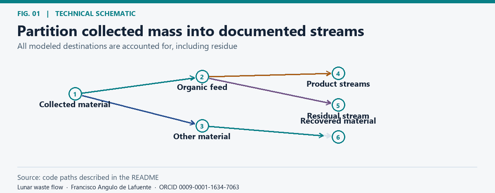
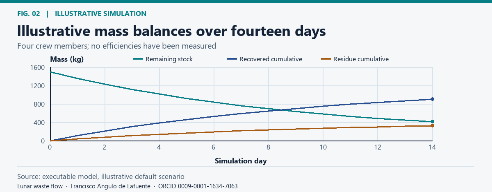
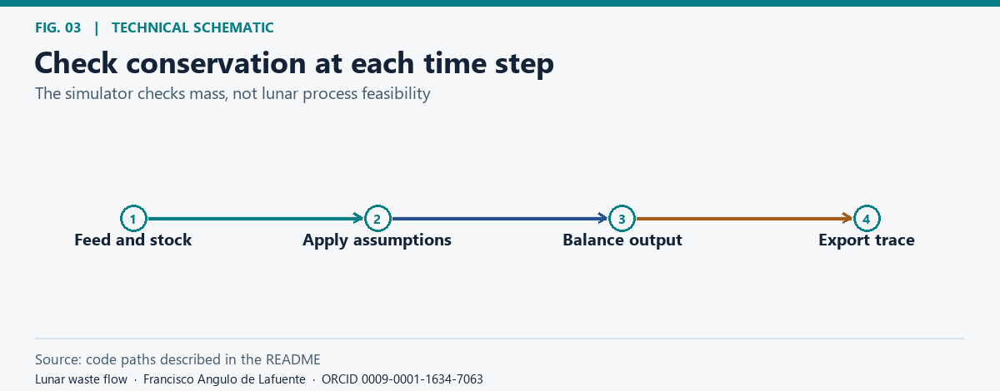
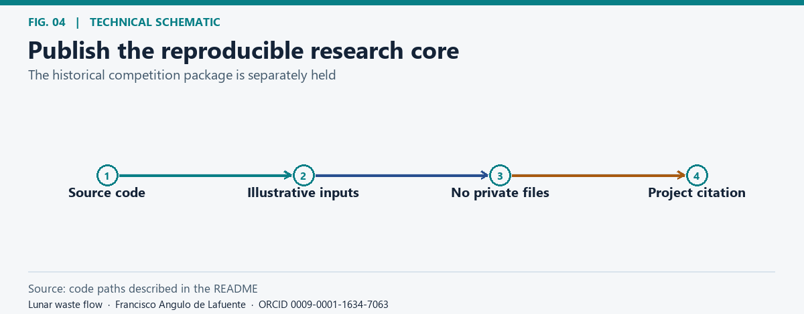

# Lunar waste flow

**Research author:** [Francisco Angulo de Lafuente](https://orcid.org/0009-0001-1634-7063) · [Citation](CITATION.cff).

**Copyright:** © 2026 Francisco Angulo de Lafuente · Attribution record updated 2026-11-06.

## Research scope

*Partition collected mass into documented streams.* [Static figure](docs/figures/flow.png).

An original, clean-room research companion to a Learning from Ants concept developed in the context of the [NASA LunaRecycle Challenge](https://www.nasa.gov/prizes-challenges-and-crowdsourcing/centennial-challenges/lunarecycle/). This small software model is not a NASA-approved design, hardware test, official challenge deliverable, or evidence of an accepted submission. Earlier proposal material and personal data remain outside this repository.

## Illustrative simulation

*Illustrative mass balances over fourteen days.* [Static figure](docs/figures/mass.png).

The scenario inherits illustrative inputs of 1.5 kg organic and 1.0 kg other waste per crew member per day, with a nominal processing fraction of 10% per day. The model explicitly books residual mass. These are software assumptions, not measured conversion yields, energy requirements or predictions for lunar use.

## Reproduce

*Check conservation at each time step.* [Static figure](docs/figures/verify.png).

Run python src/waste_flow.py --days 14 --crew 4. The model prints a daily JSON trace to standard output and checks conservation at each step. Extend it with independently measured stream composition and explicit uncertainty before using it for any design decision.

## License and citation

*Publish the reproducible research core.* [Static figure](docs/figures/rights.png).

The current intended MIT scope covers only the original software files listed in [LICENSE_SCOPE.md](LICENSE_SCOPE.md). Figure specifications, rendered figures, and documentation sit outside that file list. The initial public commit used a standard MIT License without a file-level scope, so its historical interpretation for figures and documentation remains unresolved; this scope note does not revoke any prior rights. The former cover image is omitted from the current branch because its source and license were not recorded; it remains in the original public commit history. No proposal attachments, credentials, or private team details are included in the current source tree.

## Bibliography and proposed checks

- [NASA, LunaRecycle Challenge](https://www.nasa.gov/prizes-challenges-and-crowdsourcing/centennial-challenges/lunarecycle/). This repository is an independent research companion, not an official challenge deliverable.
- [Official Phase 1 Challenge Rules, September 30, 2024](https://lunarecyclechallenge.ua.edu/wp-content/uploads/2024/09/NASAs-LunaRecycle-Phase-1-Rules-1.pdf), section “Intellectual Property Rights.”
- [Official Phase 2 Challenge Rules, Revision 5, August 24, 2026](https://lunarecyclechallenge.ua.edu/wp-content/uploads/2026/08/NASAs-LunaRecycle-Challenge-Phase-2-Official-Challenge-Rules-Rev5.pdf), sections “No Recommendations or Limitations for Software” and “Intellectual Property Rights.”

Both rulebooks leave intellectual property and software rights with each respective team and describe a possible negotiated U.S. license. They do not establish ownership of any prior team submission. This repository contains no archived proposal or submission package; no new license is asserted over such material.

**Attribution.** Cite [Francisco Angulo de Lafuente](https://orcid.org/0009-0001-1634-7063) using [CITATION.cff](CITATION.cff). The current intended MIT scope is listed in [LICENSE_SCOPE.md](LICENSE_SCOPE.md); the initial public commit did not define a file-level scope. Preserve applicable copyright and permission notices and do not present this work as your own. [License](LICENSE) · [License scope](LICENSE_SCOPE.md) · [Figure methods and provenance](docs/figures/README.md).

This project contains open-source material under the MIT License. When redistributing copies or substantial portions, retain the copyright and permission notices. If you build on this work, please cite the project and credit Francisco Angulo de Lafuente (ORCID: 0009-0001-1634-7063). Help advance scientific knowledge: we welcome reproducible results, corrections, and contributions.

<!-- research-provenance: project=lunar-waste-flow-simulation; edition=2026-11-04; recorded_on=2026-11-06; creator=Francisco Angulo de Lafuente; orcid=https://orcid.org/0009-0001-1634-7063; figure-renderer-license=MIT; license-scope=LICENSE_SCOPE.md -->
