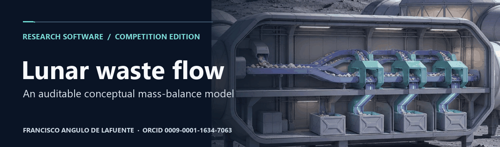

# Lunar waste flow

**Research author:** [Francisco Angulo de Lafuente](https://orcid.org/0009-0001-1634-7063) · [Citation](CITATION.cff).

## Research scope

*Partition collected mass into documented streams.* [Static figure](docs/figures/flow.png).

An original clean-room research companion to the Learning from Ants concept prepared for [NASA LunaRecycle](https://www.nasa.gov/prizes-challenges-and-crowdsourcing/centennial-challenges/lunarecycle/). This is a small software model, not a NASA-approved design, hardware test, or evidence of an accepted submission. Earlier proposal material and personal data remain outside this repository.

## Illustrative simulation

*Illustrative mass balances over fourteen days.* [Static figure](docs/figures/mass.png).

The scenario inherits illustrative inputs of 1.5 kg organic and 1.0 kg other waste per crew member per day, with a nominal processing fraction of 10% per day. The model explicitly books residual mass. These are software assumptions, not measured conversion yields, energy requirements or predictions for lunar use.

## Reproduce

*Check conservation at each time step.* [Static figure](docs/figures/verify.png).

Run python src/waste_flow.py --days 14 --crew 4. The model writes a daily JSON trace and checks conservation at each step. Extend it with independently measured stream composition and explicit uncertainty before using it for any design decision.

## License and citation

*Publish the reproducible research core.* [Static figure](docs/figures/rights.png).

The original implementation uses [MIT](LICENSE). It includes no proposal attachments, external graphics, site credentials or private team details. Cite the original author.

## Bibliography and proposed checks

- [NASA, LunaRecycle Challenge](https://www.nasa.gov/prizes-challenges-and-crowdsourcing/centennial-challenges/lunarecycle/). Separate conceptual digital twin evidence from the requirements for an accepted challenge entry.

**Attribution.** Cite [Francisco Angulo de Lafuente](https://orcid.org/0009-0001-1634-7063) using [CITATION.cff](CITATION.cff). Original MIT software is open source where the license applies. Preserve applicable copyright and permission notices and do not present this work as your own. [License](LICENSE) · [Figure methods and provenance](docs/figures/README.md).

<!-- research-provenance: project=lunar-waste-flow-simulation; edition=2026-11-04; creator=Francisco Angulo de Lafuente; orcid=https://orcid.org/0009-0001-1634-7063; figure-renderer-license=MIT -->
